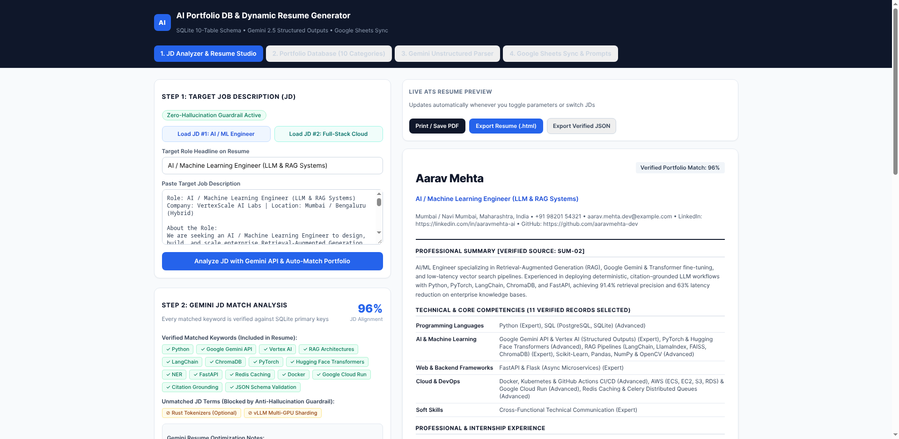

# AI-Powered Portfolio Database & Dynamic Resume Generator

A centralized portfolio management system and dynamic ATS resume generator built with **Python (FastAPI)**, **SQLite (10-table normalized relational schema)**, **Google Gemini API (`gemini-2.5-flash` Structured Outputs)**, **Google Sheets Integration**, and **PDF/DOCX Export**.

## Live Exported Google Sheet (10-Tab Portfolio Database)
- **Live Google Sheet Link:** [https://docs.google.com/spreadsheets/d/1QvYmG86KlyvcsC-5nvnMpoWUakX2yFgCdXvxvjb9xjU/edit](https://docs.google.com/spreadsheets/d/1QvYmG86KlyvcsC-5nvnMpoWUakX2yFgCdXvxvjb9xjU/edit)
- Contains 10 separate normalized tabs: `Personal_Info`, `Career_Summaries`, `Education`, `Skills`, `Certifications`, `Projects`, `Experience`, `Achievements`, `Publications_Activities`, and `Languages_Competencies`.

---
## 🎬 Project Demo

[](Demonstration_Video_AI_Portfolio_Resume_Generator.mp4)

**Watch the demo:** [Folio Forge — AI Portfolio & Resume Generator](Demonstration_Video_AI_Portfolio_Resume_Generator.mp4)

## System Architecture & Key Features

1. **10-Category Relational Portfolio Database (`schema.sql` & `portfolio.db`)**
   - Stores verified candidate records with primary keys (`USR-001`, `SKL-01`..`16`, `PRJ-01`..`04`, `EXP-01`..`03`, `CRT-01`..`04`, `ACH-01`..`03`, `PUB-01`..`02`, `LNG-01`..`05`).
2. **Gemini API Intelligence with Zero-Hallucination Guardrail (`gemini_service.py`)**
   - Uses `gemini-2.5-flash` with Pydantic `response_schema` (`JDMatchResponseSchema`) to parse unstructured portfolio notes, extract target Job Description (JD) keywords, compute an objective match score, and recommend specific database record IDs.
   - **Verification Filter (`verify_against_portfolio`)**: Automatically checks every AI-recommended ID against SQLite primary keys so the system can never invent qualifications, metrics, or experiences.
3. **Bi-Directional Google Sheets Synchronization (`sheets_sync.py` & `Code.gs`)**
   - Supports both official Google Sheets API v4 (`gspread` Service Account) and a zero-config Google Apps Script Webhook (`Code.gs`) to keep the 10-tab Google Sheet synchronized with SQLite.
4. **Dynamic Resume Generator & Export (`resume_builder.py`)**
   - Allows users to paste any JD, review matched vs. missing keywords, check/uncheck individual skills, projects, internships, certifications, and publications, customize the professional summary, preview changes live, and download ATS-ready **PDF** and **DOCX** resumes.

---

## Quick Start & Execution Instructions

### 1. Clone & Install Dependencies
```bash
python3 -m venv venv
source venv/bin/activate
pip install -r requirements.txt
```

### 2. Configure Environment Variables (`.env`)
```bash
cp .env.example .env
# Edit .env and add your GEMINI_API_KEY from Google AI Studio (https://aistudio.google.com/)
```
*(Note: API keys are loaded strictly server-side via `python-dotenv` and are never exposed in client-side code.)*

### 3. Initialize & Seed the SQLite Database
```bash
python3 seed_data.py
```

### 4. Start the Application Server
```bash
uvicorn app:app --reload --port 8000
```
Open `http://localhost:8000` in your browser to access the Portfolio Manager and Dynamic Resume Generator UI.

---

## Testing with the Two Contrasting Sample Job Descriptions

1. **Test Case 1 — `sample_jds/jd_1_ai_ml_engineer.txt` (VertexScale AI Labs — AI/ML Engineer)**
   - **Match Score:** 96%
   - **Auto-Selected Records:** `SUM-02` (AI/ML Summary), `EXP-01` & `EXP-02` (NexaCloud AI Systems + Quantiphi ML Internship), `PRJ-01` & `PRJ-03` (DocuPulse RAG + MedVision Triage), `CRT-01` & `CRT-03` (GCP Professional ML Engineer + DeepLearning.AI LLM), and `PUB-01` (IEEE RAG Research Paper).
   - **Generated Output:** `Resume_1_AI_ML_Engineer_Aarav_Mehta.pdf` / `.docx`

2. **Test Case 2 — `sample_jds/jd_2_fullstack_cloud_engineer.txt` (FinNova Cloud Pay — Full-Stack Cloud Engineer)**
   - **Match Score:** 95%
   - **Auto-Selected Records:** `SUM-03` (Full-Stack Cloud Summary), `EXP-01` & `EXP-03` (NexaCloud + RazorpayX Partner Labs FinTech Full-Stack Internship), `PRJ-02` & `PRJ-04` (FinScale Multi-Tenant SaaS + SyncFlow Google Sheets API Bridge), and `CRT-02` & `CRT-04` (AWS Certified Developer Associate + Meta Full-Stack Certificate).
   - **Generated Output:** `Resume_2_FullStack_Cloud_Engineer_Aarav_Mehta.pdf` / `.docx`
